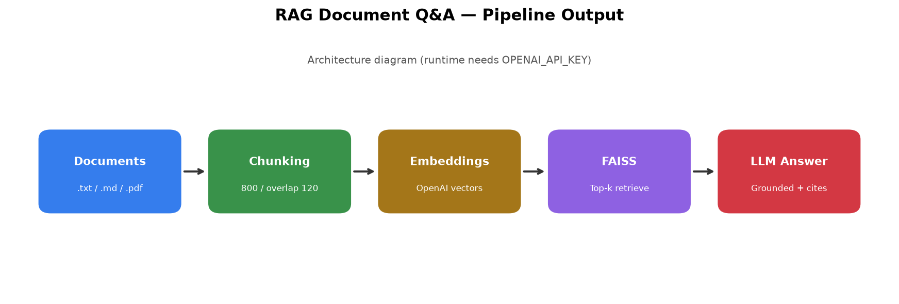
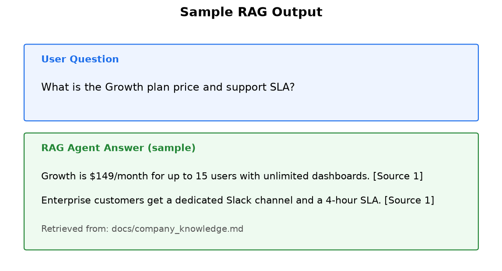

# RAG Document Q&A Agent

[](https://github.com/alirazach476/rag-document-qa-agent/actions/workflows/ci.yml)
[](https://www.python.org/downloads/)
[](LICENSE)

A Retrieval-Augmented Generation (RAG) agent built with **LangChain**, **FAISS**, and **Ollama** (free local) or **OpenAI**.

Upload documents, build a local vector index, and ask grounded questions with source citations — via CLI or Streamlit.



## Features

- **Free local mode** — GPU embeddings (sentence-transformers + CUDA) + [Ollama](https://ollama.com) chat
- Optional OpenAI provider when you have credits
- Load `.txt`, `.md`, and `.pdf` documents from `docs/`
- Fast batched GPU indexing with progress UI
- Persistent FAISS vector store (separate indexes per embedding backend)
- Grounded LLM answers that cite `[Source N]` snippets
- CLI + Streamlit chat UI
- Tests and GitHub Actions CI

## Architecture

1. Documents are split into overlapping chunks  
2. Chunks are embedded (Ollama or OpenAI) and stored in FAISS  
3. A question retrieves the top-k similar chunks  
4. The LLM answers **only** from that context (or says it does not know)

```
docs/  →  chunk  →  embed  →  FAISS  →  retrieve  →  LLM  →  answer + sources
```

## Quick start (free with Ollama)

1. Install [Ollama](https://ollama.com) and pull a chat model (embeddings use your GPU directly):

```bash
ollama pull llama3.2
```

For NVIDIA GPUs, install a CUDA build of PyTorch so `EMBEDDING_DEVICE=cuda` works.

2. Install this project:

```bash
git clone https://github.com/alirazach476/rag-document-qa-agent.git
cd rag-document-qa-agent

python -m venv .venv
# Windows
.venv\Scripts\activate
# macOS / Linux
# source .venv/bin/activate

pip install -e ".[dev]"
copy .env.example .env   # Windows — or: cp .env.example .env
```

`.env` defaults to `LLM_PROVIDER=ollama` (no OpenAI key needed).

A sample knowledge base lives in [`docs/company_knowledge.md`](docs/company_knowledge.md).

### CLI

```bash
python rag_agent.py
```

Commands: ask a question, `rebuild` to re-index, `quit` to exit.

### Streamlit UI

```bash
streamlit run app.py
```

Upload files → **Rebuild vector index** → ask questions in the chat.



## Paid OpenAI mode (optional)

In `.env`:

```
LLM_PROVIDER=openai
OPENAI_API_KEY=sk-...
OPENAI_MODEL=gpt-4o-mini
EMBEDDING_MODEL=text-embedding-3-small
```

Then rebuild the index (OpenAI and Ollama indexes are stored separately).

## Configuration

| Variable | Default | Description |
|----------|---------|-------------|
| `LLM_PROVIDER` | `ollama` | `ollama` (free) or `openai` |
| `EMBEDDING_BACKEND` | `auto` → `local` | `local` (GPU), `ollama`, or `openai` |
| `EMBEDDING_DEVICE` | `cuda` / `auto` | Use NVIDIA GPU when available |
| `EMBEDDING_MODEL` | `all-MiniLM-L6-v2` | Local embed model |
| `EMBED_BATCH_SIZE` | `64` | Chunks per embed batch |
| `OLLAMA_BASE_URL` | `http://127.0.0.1:11434` | Ollama server |
| `OLLAMA_MODEL` | `llama3.2` | Local chat model |
| `OPENAI_API_KEY` | — | Required only for OpenAI mode |
| `OPENAI_MODEL` | `gpt-4o-mini` | OpenAI chat model |
| `CHUNK_SIZE` | `1200` | Chunk character size |
| `CHUNK_OVERLAP` | `100` | Overlap between chunks |
| `TOP_K` | `4` | Retrieved chunks per question |
| `TEMPERATURE` | `0.1` | LLM temperature |
| `DOCS_DIR` | `docs` | Document folder |
| `VECTOR_DIR` | `vectorstore/<backend>` | FAISS folder |

## Project layout

```
rag_qa/           core package (config, providers, ingest, store, chain, cli)
app.py            Streamlit frontend
rag_agent.py      CLI entry
docs/             sample / uploaded documents
tests/            unit tests
vectorstore/      FAISS indexes (gitignored; per provider)
```

## Development

```bash
ruff check .
pytest -q
```

See [CONTRIBUTING.md](CONTRIBUTING.md).

## Deploy

### Why not Vercel?

**Vercel cannot host this app.** Streamlit needs a long-running Python process and WebSockets. Vercel only runs short serverless functions / static frontends. Local **Ollama** and **GPU embeddings** also cannot run on Vercel.

Use one of these instead:

### Streamlit Community Cloud (easiest)

1. Push this repo to GitHub (already: `alirazach476/rag-document-qa-agent`).
2. Go to [share.streamlit.io](https://share.streamlit.io) → **New app**.
3. Select the repo, main file `app.py`.
4. Under advanced settings, set requirements file to `requirements-cloud.txt`.
5. Add secrets (OpenAI mode — cloud has no Ollama/GPU):

```toml
LLM_PROVIDER = "openai"
EMBEDDING_BACKEND = "openai"
OPENAI_API_KEY = "sk-..."
OPENAI_MODEL = "gpt-4o-mini"
EMBEDDING_MODEL = "text-embedding-3-small"
```

You need OpenAI credits for cloud deploy.

### Railway / Render / Docker

```bash
docker build -t documind-rag .
docker run -p 8501:8501 \
  -e LLM_PROVIDER=openai \
  -e EMBEDDING_BACKEND=openai \
  -e OPENAI_API_KEY=sk-... \
  documind-rag
```

Point the host at the `Dockerfile` and set the same env vars.

### Local (free)

Keep using Ollama + GPU on your PC — that path stays free and does not need Vercel.

## Troubleshooting

| Issue | Fix |
|-------|-----|
| Cannot reach Ollama | Start the Ollama app; confirm `http://127.0.0.1:11434` |
| Model not found | `ollama pull llama3.2` |
| OpenAI `insufficient_quota` | Switch to `LLM_PROVIDER=ollama` or add billing credits |
| Answers ignore new uploads | Click **Index this PDF** after uploading |
| Weird retrieval after switching provider | Rebuild — each provider uses its own index folder |
| Deploy on Vercel failed | Expected — use Streamlit Cloud or Railway (see above) |

## License

MIT — see [LICENSE](LICENSE).
